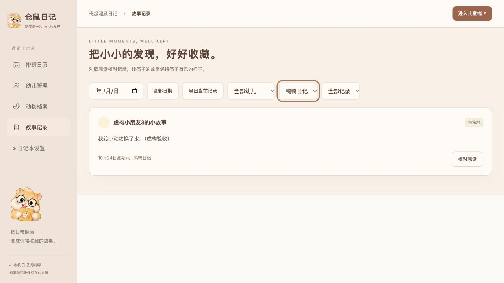
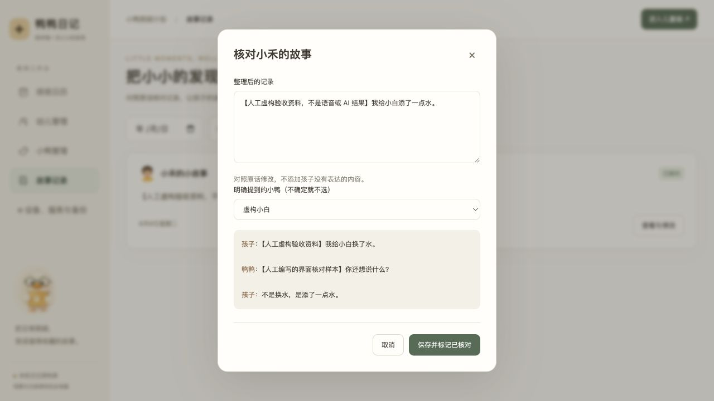
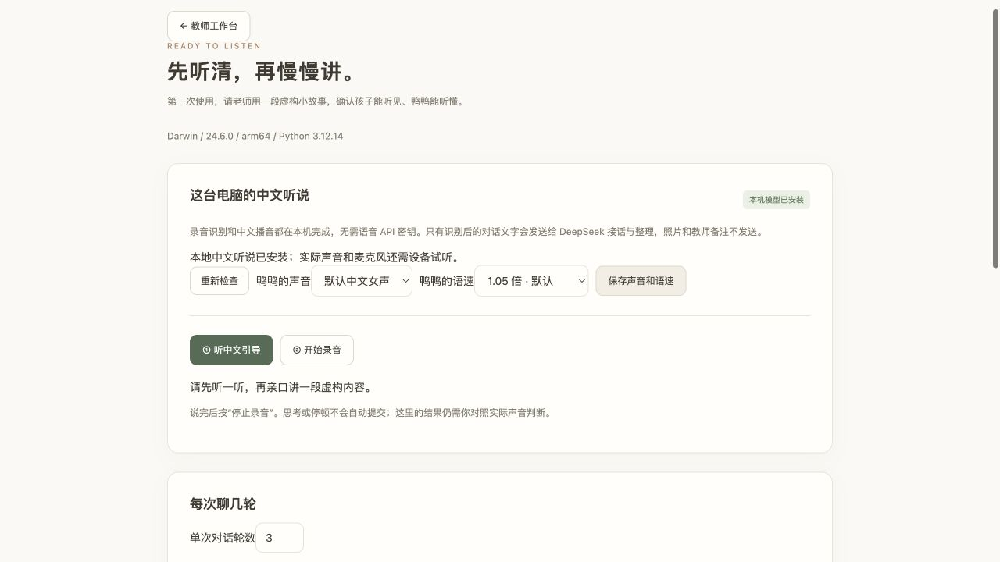

# Pomegranagent V2 · 鸭鸭日记本

**让孩子自然讲述照顾动物的经历，让老师留下忠实、可回看的记录。**

这是一款在教师电脑上运行的幼儿交流与记录应用。教师准备幼儿、动物和当天名单，孩子选择自己的大头像，用空格键和日记本朋友聊一聊；主持人随教师装修，故事自动保存，教师随后核对、修改和备份。

**上一交付版已于 2026-09-09 获用户验收通过；本轮对话优化进入验证，整体效果尚未验收通过。** 这是独立开发的 V2，正式应用与历史交互原型分别保留。具体设备实测范围见下方[验收与运行环境](#验收与运行环境)，用户验收结论不代替未记录的平台实机结果。


[教师使用说明](docs/user-guide.md) · [产品范围与交互约定](docs/product.md) · [后续开发说明](docs/development-start.md) · [IP 与声音素材](docs/mascot.md)

## 当前声音：Qwen 好奇女孩（2026-11-17）

用户从本地试听中选定“好奇女孩”。正式播音已替换为 Qwen3-TTS 1.7B Base，固定使用随项目附带的合成参考音频。默认沿用试听轻快版：整段平均约 3.55 汉字/秒、保持音高的变速与 -23 LUFS 音量对齐；变速范围限制在 0.75–1.4，不能保证每句话恰好达到目标。MyEval 已确定的对话提示词与措辞不在本轮修改范围。

每次回复整段合成，不再分句、前瞻或排队生成。识别→接话→合成共用一次等待：超过 800ms，从随包附带的 10 条短提示中随机播放一条，避开上一条；每条 1.39–1.96 秒。回复就绪时等当前短提示自然结束再播，失败、退出、换人会停止旧播放与合成。17 条常用引导和安全退出提示也已预生成，模型忙时仍可播放。后端只有一个合成槽位，其他窗口的实时请求会得到明确忙碌提示，不积压旧回复。

Mac 使用 MLX 4-bit；Windows x64 + NVIDIA 使用独立 CUDA/PyTorch 环境和官方 Base 权重，共用同一参考音色。安装/运行代码、参考音频、预生成音频、版本与文件校验清单均在项目内；运行不依赖 `.acceptance` 或个人模型缓存。权重位于被 Git 忽略的 `models/`，完整离线发行包将权重、Python 和依赖一起携带。语音推理不访问云端语音 API。

本机集成检查使用 M1 Pro / 16GB：一条冻结 MyEval 回复生成 15.17 秒音频，完整合成与后处理 5.91 秒；单次实测，不能当作稳定时延承诺。活动合成取消约 22ms，随后可重新加载生成；模型忙时固定退出提示约 1ms 取得。10 条等待音频经本地辅助转写逐字匹配，仍需人耳判断。Windows / RTX 4060 尚未实测。

在 `8787` 隔离虚构资料中，实际 Chrome 操作完成真实新 C 接话→Qwen 整段播放→固定收尾→自动保存，SQLite/HTTP 读回一条记录、原话一致、`summaryFallback:false`。长语音准备中按 Esc 返回选人，合成进程已停止、草稿保留、没有新增记录。旧验收服务配置最初接话失败，换用本轮 MyEval 已用的运行时配置后通过；没有把该失败记为成功，也没有修改正式资料或打包密钥。

Mac 离线包已解压到独立目录，用包内 Python 与两组依赖，在操作系统禁止所有网络、禁止读取原项目模型/虚拟环境/原 Python 的条件下，完成实际 Qwen 合成和 SenseVoice 识别。该次冷路径约 44 秒（含首次加载、依赖初始化和识别，不是单次回复耗时）。证据保存在 `.acceptance/qwen-integration-20261117/`；真实儿童声音、设备听感与 Windows 仍待验收。未新增单元测试。

旧动物音效试听入口 `/animal-call-preview.html` 保留，叫声是预录文件，语音正文使用新的本地声音。

## 当前默认：新 C 日记本朋友（2026-11-13）

普通 `server.py`、`launch.command` 和 `launch.bat` 启动默认使用 `reference-companion-v5` / `5.0.1`；唯一默认值位于 `backend/agent_profiles.py` 的 `DEFAULT_DIALOGUE_PROFILE`，服务未提供 `ai_options` 或未指定 `dialogue_profile` 时也走同一路由。聊天一次生成，完整提供冻结的八段原创虚构多轮示范；整理独立调用，只输入本次儿童原话。提示词、示范、`relevant-same-child-v3` 历史选择和整理约定保持原评测版本，没有继续优化提示词。示范不是教师金标，也不代表当前儿童经历。

新 C 允许贴合情境的拟人化、美好想象和自然欣赏，分清现实动作、纠正、未完成打算与安全边界，不要求每轮复述或贴表扬标签。主持人取自教师装修，与实际动物分开；沿用现有录音、播音与叫声逻辑。历史按相关性选最多三篇同一幼儿的合格记录，无关时留空；历史池仅在内存驻留期间固定，重启或缓存淘汰后会重建。非收尾轮按需最多问一个问题，末轮及明确停止不追问；默认 3 轮和应用收尾保存流程不变。详见[产品约定](docs/product.md#真实-ai-接话与忠实整理)。

用户已选择新 C 的产品风格；先前虚构情境评测没有教师评分，不能据此宣称泛化或真实儿童体验已通过。本会话负责默认接入和语法、差异检查；真实 HTTP、连续浏览器操作、保存读回、重启持久化与实际性能统一由 MyEval 主会话验收，结果不以启动成功代替。

本次集成另加应用结束控制：主会话实际浏览器发现模型对“我讲好了”返回未结束。现在将最后一段儿童原话末尾的“我讲好了／我说完了／今天不聊了”等明确当下结束表达交给应用收尾，并在模型请求前禁止追问。也接住“我讲好了，但是我还要接着画”这类随后明确继续绘画、涂色、积木或手工的有限表达；同一活动之后明确延后的“画完再告诉你”仍按当下结束处理。后续要立即继续说话、否定、完成其他活动、引号内或带过去/转述前缀的表述不因包含关键词而触发，也不把单独出现“再告诉你”当结束。这是完整末尾句段匹配的有限规则，其他表达仍由模型理解；按钮结束保持原行为。该控制不是冻结提示词的一部分，原 192 个 trial 的成绩不证明新增控制后的全部行为。

开发检查：`python -m py_compile backend/app.py backend/agent_profiles.py backend/dialogue_v3.py backend/friend_profiles_v5.py server.py` 与 `git diff --check` 通过。普通启动在隔离空资料目录打印了新 C / 5.0.1，随后停止；没有接触正式资料。本会话快照和相对差异位于忽略目录 `.acceptance/new-c-default-20261113/`。

主会话最终固定 17 个真实 HTTP 结束边界样例均符合预期：6 个明确结束样例在请求模型前禁问且最终收尾，11 个否定、引用、继续讲述等样例未被误关。先前 12/13 的 keep-drawing 漏判和 16/17 的 later-chat-after-drawing 漏判原始结果均保留，不改记为通过。缺少 `ai_options` 的真实 Handler 请求已验证新 C 单次 candidate 与独立 summary；显式 baseline 已验证 candidate + review 与 summary，均 HTTP 200。固定样例通过只证明这些结束边界，不证明通用意图理解或所有回应质量。

主会话在实际浏览器恢复预存的虚构儿童原话，点击普通“接着说”，在最终源码下完成自动收尾、真实整理与自动保存，全程未点击结束或保存按钮。教师端读回记录，`summaryFallback:false`，儿童草稿已清理；该样本的日记没有混入聊天中的历史或拟人化内容。服务真实重启后完整状态相同，SQLite 与 HTTP 记录逐字一致，浏览器再次读回成功。证据位于 MyEval 的 `.local/acceptance/pome-new-c-rollout-20261113/`，包括 `final-acceptance-audit.json`、`stop-final-audit.json`、`ui-auto-saved.jpg` 和 `ui-after-restart.jpg`。这条路径从虚构文字开始，不是 ASR、真实儿童声音或听感验收，Windows 也未验证。

本次接入与修复共 79 次真实聊天/整理 HTTP、80 次模型调用，均执行成功，保留三次结束意愿漏判的语义失败。最初 19 次自然多轮/浏览器接话的服务端完整 HTTP p50/p95 为 2.66/5.14 秒；最终版本 17 个较短边界样例加一次浏览器接话为 1.96/2.84 秒，输入不同，不能据此称为提速。原评测与本次功能验收分开，仍有部分复述、额外建议和历史相关性不足。

启动终端和 `GET /api/health` 的 `dialogueProfile` 可查看实际方案；每次模型响应的 `AI diagnostic` 记录方案/版本、请求模型、服务返回模型和 token 用量，不含儿童原文或密钥。运行中的旧进程不会自动加载更改。显式回退或选择其他候选时使用 `--dialogue-profile`，可选项见 `server.py --help`，例如：

```sh
# 明确使用旧的候选生成 + 审校流程；资料目录请自行选择
.venv/bin/python server.py --dialogue-profile baseline --port 8793 --data-dir .acceptance/baseline-preview
```

## 历史 baseline：对话理解与内部恢复（2026-10-26）

以下保留旧 baseline 的实现和当时验证边界；其两阶段接话及最近三篇快照规则不再是普通启动的默认方案。

本轮接入同一幼儿最近三篇故事与动物名字/类型的背景快照，排除其他幼儿、未来活动日及本篇建立之后的记录；已核对正文与未核对原话区别标注。单篇背景超过 6000 字时整篇省略正文，保留该篇日期和核对状态；旧残缺快照同样不再发送残缺事实，不用更早篇目补位，原始记录保持不变。不发送照片或教师自由备注，整理仍只依据本次原话。每轮保留鼓励或接纳，去掉强制长回复，不新增澄清问题或轮次。识别传输错误、对话服务瞬态故障及空白/无效 JSON 进行有限内部恢复，不增加轮次或重复保存；增加不含原文/录音的识别耗时与模型用量、结束原因诊断。

模型继续仅使用 `deepseek-flash`、thinking enabled / low、每次 4096 输出预算；整理 disabled / 2048。单次接话生成经过陌生样本审核仍出现补动作、次数、独立性及评价标签；同提示词的 low/high 对照也没有证明升级可解决，因此未升级。当前实现候选生成后由独立系统提示的第二次 Flash low 调用审查并直接修订，儿童只收到最终回复。两阶段共用 75 秒剩余等待预算、socket 空闲超时及一次故障重试额度：正常两次、最多三次调用；前端仍在 90 秒结束等待，不保证远端计算立即停止。代价是每轮多一次调用和额外延迟，两阶段实际接口八条复核消除了此前转圈、次数和耐心标签等越界；随后四条陌生样本未新增具体事实或澄清，耗时 4.4–6.6 秒，仍有机械复述，尚不能判定教师体验整体达标。不叠第三层，保留为待教师试用的候选。比较材料位于忽略目录 `.acceptance/dialogue-optimization/`，不属于新增测试体系。

已在 macOS 内置浏览器操作隔离虚构草稿：键盘触发真实接话、本机播音、收尾自动保存、键盘换人、教师查看原话；数据库确认仅保存一条且原话未改，整理未混入历史。隔离资料检查覆盖最近三篇选择、补录日期上限、排除他人和备注、教师修改后背景不变。语法及差异检查通过。恢复备份与排队保存的快照一致性另经差异审核修正；已在设置页实际恢复虚构完整备份，数据库确认背景快照一致。录音结束与识别完成并发排队仍待设备路径验证。设备检查接口也已用虚构文字请求真实模型通过，不读取幼儿背景。

识别模型尚未替换：合成成人语音短句链路能运行并输出诊断，但“小鸭换了水”出现“小丫换了谁”的误识别，不能宣称儿童识别准确度已提高。长录音目前仍整段识别；VAD、分段或模型替换需真实失败样本比较，未擅自上云、增加录音长期留存或猜改原话。声音可懂度、真实儿童环境与 Windows 尚待设备验收。

两阶段隔离故障检查共 11 个 HTTP 场景通过：候选/审查恢复、共享重试耗尽、鉴权/截断失败、无效 JSON、实质过滤失败；正常两次、最多三次调用，不回退未经审查的候选。候选与审查给不同正文时，响应仅为审查正文和结束意图。SQLite 原话、轮数和记录数保持不变。实际 `store.mjs` 的 4 个场景通过：同窗排队、同草稿跨窗冲突、不同幼儿草稿合并、保存后原话保护。证据位于 `.acceptance/dialogue-optimization/manual-recovery/two-stage-evidence.json` 与 `two-stage-additional.json`，仅证明恢复控制。最后在 macOS 浏览器键盘恢复虚构草稿，实际两阶段接话后自动保存；仅生成一条记录、一条儿童原话和一条最终回应，草稿移除，无候选落盘，见 `reviewed-ui-state.json`、`reviewed-ui.jpg`。语音可懂度、实际麦克风识别、录音完成与取消并发和 Windows 仍待设备验收。

离线识别候选对照：从 sherpa-onnx 官方发布下载 Fun-ASR-Nano int8 2025-12-30，校验 SHA256，与现有 SenseVoice 使用同一段约 5 秒虚构合成成人声音。两者都误识别“水”，候选另出现“小丫”；识别耗时约 765ms 对 135ms。该样本不证明儿童准确率，也不足以选型，故未替换正式模型。隔离模型及结果在 `.acceptance/asr-candidate/`；未修改安装脚本、默认模型或录音留存。下一步需要教师的真实失败表达与设备信息，不能用合成样本宣布识别已改善。

旧 baseline 隔离预览：`.venv/bin/python server.py --dialogue-profile baseline --port 8778 --data-dir .acceptance/dialogue-optimization/runtime`；儿童入口 <http://127.0.0.1:8778/index.html>。该段证据只对应当时版本，仍缺真实儿童识别样本、教师对鼓励与回应内容的反馈，以及剩余恢复路径验收。

## 本轮迭代：装修预设与教师设置

2026-10-23：按鸭鸭基准对齐三套 IP 的可见大小，覆盖教师设置预设卡及儿童全身姿态；复用原图，通过统一舞台和逐姿态留白补偿完成。已在实际页面切换三套角色，对比鸭鸭与仓鼠对话页，并确认新角色七张姿态资源正常加载；未新增测试代码。[查看对齐效果](docs/screenshots/54-ip-size-aligned.jpg)

2026-10-24：教师“日记本设置”是全应用唯一装修入口，提供鸭鸭、虎皮鹦鹉 P3、金丝熊 H1 三套预设。保存后教师日历、幼儿与动物档案、故事记录、设置页及儿童选人页统一使用该装修；主持人随装修一起变化，没有独立设置。儿童只选择自己的头像，不选择装修或主持人，也不写回装修偏好。新故事读取教师最新设置，进行中的对话及恢复草稿沿用原装修，返回选人或刷新后再读取教师设置。同一班级仍共用档案、排班与记录；装修只作为历史筛选标记，鹦鹉装修也可以记录仓鼠的故事。旧记录默认显示为鸭鸭装修。

教师入口改为“日记本设置”，按日记本装修、声音与交流、设备与服务、资料备份归类；应用装修可预览后保存。音色和语速继续使用教师配置，三套装修分别使用对应的柔和随机音效。动物档案可选择小鸭、虎皮鹦鹉或金丝熊，保留原有照片、身份和记录关联。完整备份额外包含应用装修，兼容旧版备份格式。




此前整合验收在 macOS arm64 的 Codex 内置浏览器实操：鹦鹉草稿在设置切换后恢复、真实 DeepSeek 接话与整理、播音收尾后自动保存、历史装修筛选（含无标记旧记录）、新增金丝熊档案、默认装修/语速/轮数保存并刷新、界面下载完整备份及恢复后默认装修同步。设置页在 1280、900、640 像素宽度检查布局，后两者无横向溢出。JavaScript/Python 语法与差异检查通过，未新增测试代码。

上述过程使用独立虚构资料 `.acceptance/decoration-integration`；真实对话验证从人工写入的虚构文字草稿开始，不代表真人麦克风识别验收。实际保存内容保留了“给仓鼠换水”的原话，主题标记为鹦鹉。声音可懂度、真实儿童试用及 Windows 仍待用户设备验收；模型接话质量只覆盖本次样本，不据此宣称所有回应均无推断。

本轮预览命令：`.venv/bin/python server.py --port 8775 --data-dir .acceptance/decoration-integration`。设置入口为 <http://127.0.0.1:8775/settings.html>，儿童入口为 <http://127.0.0.1:8775/index.html>。该目录和开发服务配置不提交仓库；常规启动方式仍见下文。下一项是用户体验反馈与真人听说验收。

2026-10-24 本次控制关系调整：在 `8773 / .acceptance/theme-core` 使用隔离虚构资料实操教师保存装修、教师日历与儿童页面一致、儿童端没有角色选择、进行中对话不随教师切换、返回与刷新读取新配置，以及旧草稿恢复和历史装修筛选。历史原文及 themeId 与操作前快照相同。此次只调整装修控制关系，未重新验收真实 AI、麦克风或声音听感；Windows 仍待设备验收。运行命令：`.venv/bin/python server.py --port 8773 --data-dir .acceptance/theme-core`。

## 可以做什么

| 教师准备与管理 | 儿童交流与记录 |
| --- | --- |
| 幼儿姓名、小名、可选数值学号、头像上传与裁切，档案归档与恢复 | 默认当天大头像选人，教师可指定过去日期补录；草稿按幼儿与日期隔离 |
| 实际动物的类型、名字、照片与备注 | 空格明确启停一段语音，思考停顿不自动提交 |
| 月历多人排班、姓名/小名/拼音首字母搜索 | 真实 AI 根据当前发言与上下文接话，支持补充、纠正和结束 |
| 沿用上周同日名单、整周复用，保留已有安排 | 简短中文引导、F1 重听、常驻动态鸭鸭、句级声文同步 |
| 按幼儿、日期、装修、核对状态查找和编辑记录 | 默认最多 3 轮，可由教师设为 1–20 轮 |
| 原话对照、文本导出、完整备份与恢复 | 收尾播音后 3 秒自动保存，教师事后核对 |

日记本朋友接住孩子本轮的意思和心情，自然参与分享，不做能力评分，也不要求每轮重复表扬。每条 AI 回复有 **35% 概率**加入一次当前装修对应的柔和预录动物音效，随机位于开头或末句结尾；同一页面重听同一回复保持位置。操作提示、固定收尾与日记朗读不插入鸭叫，也不逐句朗读文字“嘎／嘎嘎”。

首期不包含“今天”汇总页、AI 打分与成长评价、家长端、多园所账号、云端同步或自动排班。档案支持**归档与恢复**，不提供永久删除实体的入口。

## 看看实际界面

以下截图均来自实际应用操作，资料为虚构验收样本；部分截图展示对应功能完成时的界面。

### 在班级名单里快速安排幼儿

输入中文姓名、小名、拼音首字母或全拼筛选。筛选不会取消被隐藏幼儿的勾选，已选名单常驻搜索上方：两行预览、查看全部浮层、标签移除，保存按钮保持可见。已用 25 人虚构名单检查搜索、移除、键盘勾选、未保存保护、保存和重新打开。


### 少一点操作讲解，多一点认真倾听

选人只读短引导和小名，空格直接开启麦克风；需要时打开“怎么操作”。回应采用朋友式闲聊，长度随内容决定；不套用复述、点评、追问结构。简单纠正、不知道和结束按需要收住。沿用倾听、接纳、写日记、邀请四种姿态及原有声音和柔和鸭叫。以下截图是此前版本的界面记录，不是新 C 的验收证据。


### 用清楚的头像辨认幼儿与小鸭

幼儿照片裁切为 320×320，教师卡片与儿童大头像共用。小鸭照片也采用方形裁切和正方形卡片，实际饲养的小鸭档案与陪伴交流的 IP 分开。


[查看小鸭方形照片卡片截图（虚构素材）](docs/screenshots/39-duck-square-portrait.png)

### 教师核对，原话仍然保留

整理内容和原始对话对照展示。教师可以修改整理文字、关联明确提到的小鸭并标记已核对；幼儿原话与 AI 发言分开保留，不随核对修改。



<details>
<summary>声音设置、试听与历史操作录像</summary>



音色固定为好奇女孩；语速默认 1.0（试听轻快版），可调整，保存后下一次播音生效。旧 Kokoro 音色及其语速自动切换到新默认；之后教师保存的 Qwen 语速继续保留。运行应用后可打开[三个小伙伴音效试听页](http://127.0.0.1:8768/animal-call-preview.html)，比较独立音效、句首和句尾；鹦鹉与仓鼠素材及处理见[来源说明](web/assets/animal-call/README.md)。上图为旧版声音设置截图。

[查看历史操作录像（MP4，约 5 分 17 秒）](docs/videos/v2-operation.mp4)

录像录制于 2026-09-08，包含建档裁切、排班、样本对话、教师核对与重新找回。它使用合成虚构音频与预先准备的草稿，并剪去长时间停留；音轨只收到部分引导，AI 播音未完整录入。录像中的旧儿童核对动线已被“收尾后自动保存”替代，因此只作历史演示，不作为当前完整流程或真人听说的验收证明。原型截图、旧录像和素材保留供对照。

</details>

## 获取与启动

```sh
git clone https://github.com/ZB-ur/pomegranagent-v2.git
cd pomegranagent-v2
```

源码运行需要 **Python 3.12，64 位**；完整离线发行包已携带 Python、依赖与本机模型，解压后双击对应 `launch` 文件即可。Mac 需要 Apple Silicon；Windows 需要 NVIDIA 显卡与支持 CUDA 12.8 的驱动。正式前端是原生浏览器模块，无需 Node.js、npm 或前端构建。Git 仓库不包含 API 密钥、数据库、课堂录音、模型权重或虚拟环境；发行包也不包含课堂资料和密钥。

| 步骤 | macOS | Windows |
| --- | --- | --- |
| 准备运行环境 | 安装 Python 3.12，或使用已有的 uv | 安装带 `py` 启动器的 Python 3.12 x64 |
| 首次准备语音 | 双击 `setup-voice.command` | 双击 `setup-voice.bat` |
| 启动应用 | 双击 `launch.command` | 双击 `launch.bat` |

源码的 `launch` 会检查语音安装，缺少时调用准备脚本。脚本在项目内创建 `.venv`（应用/识别）和 `.venv-tts`（Qwen），安装固定依赖与模型，不修改全局配置。Qwen 权重 Mac 约 2.34GB、Windows 约 4.54GB，另有 SenseVoice 与运行依赖；建议分别预留 8GB / 14GB。首次准备需要联网，模型按固定 revision 和哈希校验，支持大文件断点续传；正常推理只读本地文件。来源清单见 [Qwen 模型清单](assets/voice/qwen-models.json) 和 [许可说明](assets/voice/THIRD_PARTY_NOTICES.txt)。旧 Kokoro 文件不再使用，也不打入新包。

在已完成准备的目标系统上制作离线包（不会包含资料和服务密钥）：

```sh
.venv/bin/python scripts/package_local.py --output /你的输出目录/PomegranagentV2-mac-arm64.tar.gz
# Windows 使用 .venv\Scripts\python.exe 执行同一脚本，在 Windows 上制包。
```

必须在对应系统制作包，Mac 包不能直接拿到 Windows 运行。完整包优先使用随附的 `.runtime/python` 和两组依赖目录，无需全局 Python；对话服务仍需教师配置已有账户。

也可以在准备完成后从终端启动：

```sh
# macOS
.venv/bin/python server.py --open
```

```powershell
# Windows
.venv\Scripts\python.exe server.py --open
```

| 入口 | 地址 |
| --- | --- |
| 教师工作台（默认） | <http://127.0.0.1:8768/teacher.html> |
| 儿童端（今天的名单） | <http://127.0.0.1:8768/index.html> |
| 设备、服务与备份 | <http://127.0.0.1:8768/settings.html> |

保持启动终端运行，按 Ctrl+C 停止。服务只监听 `127.0.0.1`。默认浏览器若不是 Chrome/Edge，请复制地址到支持的浏览器中；不要直接双击 HTML 文件。端口被占用时可加 `--port 8769`，相应修改访问地址。不要同时运行多份服务读写同一个资料目录。

## 第一次使用

1. **检查设备与服务。** 在设置页填写自己的 DeepSeek 地址、模型和密钥；本项目已使用 `https://api.deepseek.com` 与 `deepseek-flash`（DeepSeek V4.1 Flash）接通，模型需在自己的服务账户可用。本机语音无需另外申请语音密钥。选择声音和语速，用成人讲述的虚构内容完成听说检查。
2. **建档。** 填写幼儿姓名、小名及清晰头像，必要时维护实际小鸭的档案。原图支持 PNG/JPEG/WebP，最大 12 MB，保存时裁切为 JPEG；HEIC/HEIF 请先导出为 JPG。
3. **安排今天。** 点日历日期、勾选幼儿并保存。可以提前排班，但儿童端始终使用电脑今天的名单。
4. **让孩子讲述。** 方向键选大头像、回车进入；空格停止引导并直接打开录音，就绪时播放短提示音，再按空格停止。识别后的发言写入本机草稿，再请求真实 AI 回应和本机播音。
5. **结束并留存。** 孩子表达结束、达到轮数或选“今天讲好啦”进入收尾。当前发言先完成处理与回应，再播固定结束语；没有待处理发言时直接收尾。播完小本子高亮倒计时 3 秒，自动保存为待教师核对记录。儿童无需核对文字；未达上限时可在倒计时内按空格继续，回车或点击小本子立即保存。
6. **教师核对与备份。** 到故事记录对照原话，修改并标记已核对；下载完整 JSON 备份。文本导出用于阅读，不能代替可恢复的备份。

### 键盘与等待反馈

| 操作 | 按键 |
| --- | --- |
| 选头像、选操作 | 方向键；Tab / Shift+Tab 标准导航 |
| 确认当前操作 | 回车 |
| 开始/停止一段录音 | 空格；停顿不会提交 |
| 重听当前引导或回复 | F1，或点击鸭鸭 |
| 返回/换人 | Esc，或页面按钮；处理中受保护 |
| 收尾倒计时内继续 | 空格，仅未达轮数上限时 |
| 收尾倒计时内立即保存 | 回车或点击小本子 |

识别、AI 等待和回复播放期间有状态反馈，相关按钮和快捷键被锁定。整段正文在实际开始播放时显示；鸭叫不冒充文字发言。等待短提示与正式回复依次播放。等待超过 15 秒提供带确认的安全退出入口，停止客户端等待和本机合成并保留当前草稿/暂存录音；不会冒报完成。整段朗读上限 4000 字，超限明确提示，不截断原文；实时合成超时为 180 秒。

## 服务与数据如何流动

```text
浏览器麦克风（空格明确停止）
  → 本机 SenseVoice 识别 → SQLite 文字草稿
  → DeepSeek 根据上下文回应 → 本机 Qwen 好奇女孩整段播音 + 偶尔预录鸭叫
  → 收尾后 DeepSeek 整理 → SQLite 记录 → 教师核对 / 找回 / 备份
```

| 部分 | 当前实现 |
| --- | --- |
| 界面与录音 | HTML / CSS / JavaScript ES modules；MediaRecorder |
| 本机服务与数据库 | Python 标准库 HTTP 服务、SQLite 事务与 revision 冲突保护 |
| 语音识别 | SenseVoice Small int8，sherpa-onnx CPU |
| 中文合成 | Qwen3-TTS 1.7B Base，固定好奇女孩参考；Mac MLX 4-bit / Windows CUDA，语速独立缓存 |
| 录音解码 | PyAV；无需全局 ffmpeg |
| 对话与整理 | DeepSeek Chat Completions；接话使用 JSON 格式返回内容和结束标记 |
| 姓名搜索 | 本地 pinyin-pro，不通过网络查询幼儿姓名 |

本机识别和合成没有按次语音 API 费用；DeepSeek 调用需要联网，费用由服务商按账户用量计收。不会用固定示例接话或浏览器 `speechSynthesis` 代替正式对话和播音。

- **原始录音留在本机。** 聊天发送本次对话、同一幼儿最多三篇相关故事的必要文字背景、幼儿称呼与动物名字/类型；独立整理只发送本次儿童原话。照片和教师自由备注不发送。
- **资料保存在 SQLite。** 包含档案、裁切照片、排班、文字草稿、原始对话和核对内容。教师修改整理结果不会覆盖原话。保存记录与移除对应草稿在同一事务内完成。
- **密钥只存本机设置。** 不回传前端、不进入备份、不写入日志；数据库没有加密，需妥善保管电脑和资料目录。
- **暂存录音不是长期音频档案。** 未识别片段保存在原浏览器 IndexedDB，录音中约每 4 秒保留已收到片段；识别和文字保存成功后清除当前待处理音频。重说会保留上一段备用，但没有历史原始录音库或完整录音导出入口。
- **失败时保留可恢复内容。** AI 接话失败可重试；整理失败以识别原话保存并提示教师核对；落盘失败停留页面，不说“记好了”。同时修改同一内容发生冲突时不直接覆盖。

### 资料目录与备份

| 系统 | 默认资料目录 |
| --- | --- |
| macOS | `~/Library/Application Support/PenegranagentV2/` |
| Windows | `%LOCALAPPDATA%\PenegranagentV2\` |

项目已更名为 `pomegranagent-v2`，已有资料目录、备份格式及旧存储键中的 `Penegranagent` / `penegranagent` 标识保留，用于兼容旧资料。

可用 `--data-dir` 指定其他目录，不能置于公开的 `web/` 下。开发验收使用隔离虚构资料，例如：

```sh
.venv/bin/python server.py --port 8772 --data-dir .acceptance/ending
```

新克隆的仓库不自带这些验收资料或服务配置。不要把个人课堂资料、密钥或 `.acceptance/` 提交到公开仓库。

完整 JSON 备份包含档案、照片、排班、已识别草稿及记录，**不含服务密钥和浏览器暂存录音**。迁移前先在原浏览器完成待识别录音。恢复会替换当前资料，执行前自动在资料目录 `before-restore/` 留下原资料备份。清理浏览器缓存不会删除 SQLite 档案和文字记录，但可能删除暂存录音；突然断电前最后数秒录音不能保证恢复。

## 验收与运行环境

**2026-09-09：用户明确确认上一交付版验收通过。** 本次交付已加入一线反馈优化，新引导节奏和姿态仍待真实儿童试用反馈。以下保留开发侧已有证据与平台边界；用户本次未补充系统、浏览器和设备型号，因此不推断所有目标平台均已实测。

支持目标为 Python 3.12 / 64 位、Chrome 或 Edge 140+、1280×720 或更大桌面窗口。系统目标为 macOS 13–15（Apple Silicon / Intel）和 Windows 11 23H2/24H2（x64）；这些是项目目标范围，不等同于每一组合都已验收。Windows ARM、Safari/Firefox、移动端不在当前验证范围。

| 环境或路径 | 已有结果 | 证据边界 |
| --- | --- | --- |
| macOS 15.7.4 / Darwin 24.6.0 / arm64 / Python 3.12.14；Codex 内置浏览器与部分 Chrome 操作 | Computer Use 完成建档裁切、25 人排班、姓名搜索、儿童选人和轮换、教师核对、持久保存与重开、备份恢复 | 不据此外推其他系统/浏览器 |
| 真实服务 | 真实 SenseVoice、Kokoro、DeepSeek 通过虚构文字/合成声音调用；补充、纠正、结束与忠实整理有样本检查 | 不是儿童群体识别准确率或质量统计 |
| 当前儿童结束与播音 | Computer Use 验证无鸭叫/句首/句尾、F1 重听、空格锁定、IP 衔接、收尾倒计时、自动保存及落盘内容 | 声文为句级同步；播放日志不是主观听感测量 |
| 本轮一线反馈优化（2026-09-09） | Computer Use 验证 25 人常驻已选区、帮助/F1/Esc、空格直接进入麦克风准备与超时恢复、真实 AI 回复播音/句级文字、重听锁定和自动保存；Python/JS 语法及差异检查通过 | AI 使用明确标注的虚构文字草稿，不是浏览器真实收音；9 月 9 日未就绪；9 月 10 日已进入实际录音并检查倾听姿态，仍无真人发言质量证据 |
| 浏览器麦克风与目标设备听说 | 有用户试用反馈与本次总体验收结论；开发环境曾遇到权限后收音不就绪 | 未记录完整真人采集、设备中断恢复或真实儿童试用的独立设备报告 |
| macOS Intel、其他 macOS 目标版本 | 已提供共用实现与启动脚本 | 无可访问实机，待设备验收 |
| Windows 11 x64 / Chrome、Edge | 启动脚本、依赖发行包和图片格式路径已检查 | 无可访问实机；安装、权限、听说、键盘、存储与备份恢复待分别验收 |

2026-09-10 IP 切换修复：四联图拆为固定帧图层，消除淡出开始时先跳回抱本帧的问题；状态更新复用小鸭节点，统一播音交接。Computer Use 检查新幼儿开场、重听、多句播音及录音启停的形象交接；本次浏览器实际进入录音并显示倾听姿态，空格停止后进入处理。没有真人发言样本，不能据此确认语音识别和儿童听说质量。

2026-09-10 鼓励补充：有明确照顾行动、观察或补救尝试时给一句直接肯定，再自然闲聊；纠正、不知道和结束不硬塞夸奖。真实模型样本检查了换水洗盆、叫声差异、擦水、纠正和结束，并用 Computer Use 检查播音。样本曾出现位置和感受推断，已加强约束；最终页面样本已明确鼓励且未再推断小鸭感受，但仍出现“水是凉的吗”这种封闭追问，尚不能保证开放问法稳定。原话继续独立保留。[实际截图](docs/screenshots/51-child-encouragement.png)。

朋友式闲聊补充检查：真实 DeepSeek 连续对话覆盖添水、洒水、纠正、不知道和结束；Computer Use 用虚构文字草稿验证四句回复播音及操作恢复，该样本句间日志间隙为 0–138 毫秒。语气是否足够温暖仍需目标设备试听和儿童反馈，不能由播放日志判断。

本轮真实 DeepSeek 样本涵盖添水、擦水、比较食量、纠正、不知道及主动结束。检查时发现并收紧了添补观察细节的问题；最终四个样本未再出现该问题，不能据此保证所有输出。整理样本曾遗漏“水盆空了”，已补充保留明确观察的约束，真实服务复查保留了完整原意。教师端重新打开、核对保存及服务重启后的原始对话均已检查。新增姿态与语音节奏仍需真实儿童试用；此前麦克风超时与后来实际进入录音的结果分别如上记录。

2026-09-10 对话优化：运行配置改为 `deepseek-flash`（官方对应 DeepSeek V4.1 Flash），当前接话开启低强度思考（`thinking=enabled`、`reasoning_effort=low`），为思考和正文共预留 4096 输出 token；整理维持非思考模式。陪聊 prompt 从 1799 精简至 707 字符，整理从 508 至 208 字符；以“有内容的亲切回应、清楚真诚的肯定、必要时带一个关键细节”为核心，移除强制每轮称赞和陪聊固定例句，消除整理示例中的位置扩写矛盾。模型分开返回正文与可选追问，程序限制首轮不追问、默认三轮最多追加一次、不可连续、末轮和主动结束不追加；正文另有问号和常见追问表达拦截，不能据此保证所有中文变体均能识别。录音中点结束的意愿写入草稿并发送到后端，重开和重试保留，倒计时继续则清除。

前一版非思考模式的真实 4.1 虚构样本覆盖连续三轮、可选追问与不连续追问、末轮要求模型提问、按钮结束、纠正、不知道、明确结束、否定结束、危险行为及整理。最终三轮样本中 2 轮有直接称赞，另一轮仍以复述为主；仍见“洗了”扩成“洗干净”等修饰性扩写，鼓励稳定性和事实克制尚待后续反馈，不宣称完全解决。纠正样本不再补“在旁边”，正式入口的最终整理样本保留叙述顺序、观察和动作，未混入 AI 对小鸭情绪的猜测。

Computer Use 在 `127.0.0.1:8776` 的独立虚构资料中确认首轮具体鼓励播完恢复操作，末轮、恢复主动结束草稿均能真实接话、播音并自动保存；核对 SQLite 中原话和整理正文一致、未用整理降级。Python/JS 语法与差异检查通过；本轮未新增单测或自动测试体系，未验证真人麦克风输入或 Windows。正式 `8768` 服务已重启加载新后端，原有资料内容哈希未变，音色、语速与轮数设置保留。新的真实儿童听感及鼓励自然度待用户试用。

低强度思考补充：用虚构文字检查尝试调整、纠正并补充、末轮要求提问、主动结束和否定结束，五次完整文字返回耗时为 1.54–5.19 秒，不含识别和声音合成，也不是稳定时延承诺。纠正样本能接住孩子因水壶太重而改为拿水盆的内容；也出现过推测小鸭安全感的输出，思考模式并不保证忠实性或自然度。最终 prompt 保留不推测幼儿或实际小鸭心理的原则，没有追加固定回复例句。Computer Use 在隔离末轮草稿中触发真实接话，页面显示该虚构幼儿已记好；落盘核对保留全部原话，整理未降级，最终回复没有追问。正式 8768 已重启加载低强度思考，原有资料哈希未变。实际儿童听感和 Windows 本轮未验证。

历史亲切反馈复审（下述 100–180 字约定已由 2026-10-26 本轮规则替代）：用户实际两轮反馈暴露出“我放心了／我更放心了”的空泛重复。已取消“一句就够”和除纠正外禁复述的过度限制，采用本次用户确认的核心 prompt：普通交流通常四到六句、约 100–180 字，明确肯定具体照顾、观察和尝试，可以结合必要关键细节但不逐项重讲，不用鸭鸭自己的感受代替接话。低强度思考、追问控制和忠实整理保持。当前草稿与原有记录不修改，下一次接话使用新 prompt；已按用户最新反馈将普通交流调整为四到六句、约 100–180 字。真实虚构连续两轮分别生成四句和五句，末轮未追加追问；样本仍存在复述及修饰性扩写，未宣称整体语气已通过。Python 语法和差异检查通过，8768 已加载新 prompt，原有资料哈希未变。2026-09-10 用户确认本版效果并要求提交；这不替代未访问平台及真实儿童群体的独立验收。

上述历史交付使用 Kokoro；2026-11-17 已按用户选定音色替换为 Qwen，见本文开头。

首次使用需允许浏览器站点录音权限，并检查 macOS“隐私与安全性 → 麦克风”或 Windows“隐私和安全性 → 麦克风”的桌面应用访问。用真实扬声器和麦克风确认音量、输入设备及中文可懂度。识别可能混淆“鸭鸭/丫丫”等近音词；记录保留识别结果供教师核对，不自动编造修正。

首期不新增单元测试、不采用 TDD、不扩充自动测试体系。开发检查保留 Python/JavaScript 语法、差异和日志；功能验收以实际 Computer Use 操作与人工反馈为准。历史原型测试仅作参考。本轮仅验证受影响的语音操作、AI 回复、IP 与排班已选区；没有扩充自动测试体系。

## 代码与文档结构

```text
backend/                 本机 API、SQLite、语音模型封装
web/                     正式儿童端、教师端、设置与静态素材
  assets/duck-poses/     新增倾听、接纳、写日记与邀请姿态
  assets/duck-call/      已采用鸭叫及署名、处理说明
  assets/quack-preview/ 历史试听小样
  vendor/pinyin-pro/     本地姓名搜索依赖及 MIT 许可证
scripts/setup_voice.py  语音依赖与模型准备
server.py               正式启动入口，默认 8768
setup-voice.* / launch.* 两端准备与启动脚本
prototype/ / run.py      历史交互原型，默认 8767
docs/                    产品、使用说明、截图与历史录像
AGENTS.md                项目开发和验收规则
```

保留原型用于理解早期交互，运行 `python3 run.py`，打开 <http://127.0.0.1:8767/> 和 `/teacher.html`。原型使用固定示例接话、浏览器语音和浏览器存储，并包含已被正式版替换的儿童核对流程；不要将它作为正式入口或真实 AI 服务验收依据。

## 素材与依赖说明

- 鸭鸭绘本 IP 与虚构示例头像：已有生成素材，制作说明见 [docs/mascot.md](docs/mascot.md)。
- 正式鸭叫：qubodup 的 [Duck Quack](https://freesound.org/people/qubodup/sounds/442820/)，改编自 dobroide 的 [20130403_duck.04.wav](https://freesound.org/people/dobroide/sounds/185134/)，采用 CC BY 4.0；本应用做柔化、降音量、淡入淡出及拼接。[完整署名与处理说明](web/assets/duck-call/README.md)。
- 上一版试听素材、当前试听样音及其授权：[试听素材目录](web/assets/quack-preview/README.md)。
- 本地拼音搜索：[pinyin-pro 3.29.3 / MIT](web/vendor/pinyin-pro/README.md)。
- 本机语音模型：版本、来源和哈希固定在 [准备脚本](scripts/setup_voice.py) 与 [Qwen 清单](assets/voice/qwen-models.json)。Qwen Apache 2.0 许可附在项目内；SenseVoice 包内许可引用 FunASR 授权说明，不将所有模型一概标成同一种许可证。

后续维护请先读 [AGENTS.md](AGENTS.md) 和[产品说明](docs/product.md)，按新反馈验证受影响路径。后续优先让儿童试用精简引导、具体鼓励和新姿态，并补齐有条件访问的目标设备记录。

### 学号与历史补录（2026-09-10）

幼儿档案可填写正整数学号，在班幼儿不可重复，留空可移除；数值不保留前导零。幼儿管理和排班输入完整学号精确筛选，儿童头像卡与对话身份条显示暖黄色学号标签。旧资料无需补齐学号。

教师在排班日历选过去日期并保存名单，点“补录故事”进入。儿童端持续显示活动日期，开场问那天的经历；记录按活动日期检索，实际创建时间仍保留。今天与各补录日期的草稿相互独立，兼容旧草稿与旧备份，不支持未来日期补录。

本轮在 macOS 的 Computer Use 中使用隔离虚构资料（`http://127.0.0.1:8774/teacher.html`）验证：25 人学号筛选、重复学号拦截、历史日历入口与未保存保护、大头像学号显示、键盘进入、真实 AI 回应后自动保存、返回今天恢复旧草稿、教师按活动日期与学号找回并核对。服务重启与隔离完整备份恢复后，学号、分日草稿及补录记录仍保留；非法学号接口返回 400，未来日期入口拒绝录入。Python/JS 语法与差异检查通过。AI 使用明确标注的虚构文字草稿，未验证本轮真人麦克风收音、儿童对日期与学号的理解及 Windows 实际运行。正式运行入口仍为 `http://127.0.0.1:8768/teacher.html`，服务已加载本轮后端。

排班布局更新：顶部采用紧凑工具栏，单日编辑区加宽至约 350px，保存与补录并排；全部已选通过浮层查看，窄窗口改为单日抽屉。Computer Use 在 macOS 上验证 1280×720 桌面（25 人已选时候选区约 245px、完整可见 5 行、操作栏约 53px）、800×720 抽屉、六周月份、已选浮层移除、学号搜索、未保存保护、保存后重新打开及复用入口。JS 语法和差异检查通过。本轮没有重测未改动的儿童听说链路，Windows 实机仍待验收。

排班列表视觉收尾：候选与已选名单用独立浅黄色学号标识区分姓名；候选行减少分隔线，选中使用淡绿色底。顶部合并为“复用安排”菜单，并标明当前日期。Computer Use 验证整周设置入口、单日沿用 25 人名单及未保存保护，候选列表仍保持五行完整可见。
